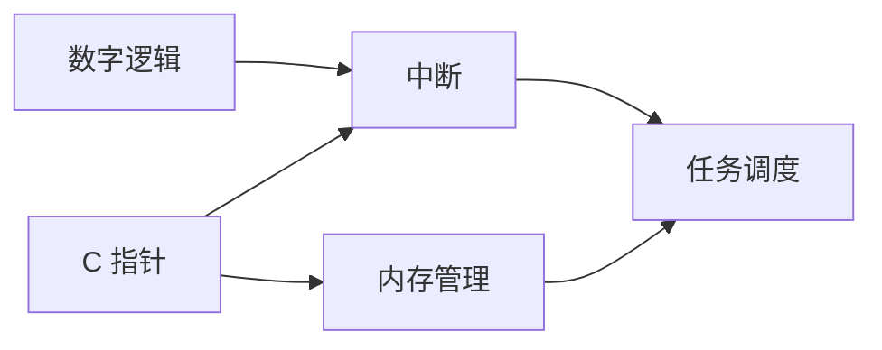

# DeepLearn

> 通用的知识拆解与学习引擎 Skill —— 把任何学习目标递归拆到知识原子，用三张图组织认知，用迁移任务验证真正理解。

*A general-purpose Agent Skill for recursive knowledge decomposition, prerequisite graphs, progressive teaching, and transfer-based mastery.*

---

## 它是什么

DeepLearn 是一个**通用** AI Skill（不是应用、不是脚本、不绑定任何学科或工具）。它给执行任务的 Agent 提供一套可复用的方法论：拿到任意学习目标后，先分类、建图、排序，再按用户选择的分支逐层深挖，一次只教一个节点，用练习和迁移任务验证理解，并把进度持久化。

核心信念：**一切皆可拆解；每个复杂概念都有更简单的依赖；每条学习路径最终都应抵达原理、机制、公理或可实验验证的事实。**

## 它不是什么

- 不是通用答疑 / 家教机器人，不直接给习题答案。
- 不是资料清单或课件生成器，不堆「推荐 10 本书」。
- 不是一次性吐出几万字讲义的提示词模板 —— 首轮响应硬上限 40 行。
- **不是把概念列成目录就宣称拆完的工具** —— 见下文 V2 质量门禁。

## 工作原则

> 先建立全局认知，再进行局部深挖；先理解底层原理，再掌握上层应用；先验证理解，再进入下一个知识点。

交互循环：

```
用户提出目标 → 分类 + 三图全局概览（≤40 行）
           → 用户选分支 / 接受推荐路线
           → 对该分支递归拆解到 L5/L6 并过六问验收
           → 用户选具体知识点 → 单节点深度教学
           → 练习验证 → 更新三图与掌握度 → 下一节点
```

任何 Mode 都允许随时切换，切换不重建知识图。

## 最关键的差别：三张图

同一批知识节点，三种关系回答三个不同问题。**把「必须先于」画进结构树，或把教材章节顺序当路线图，是最常见的错误。**

| 图 | 边语义 | 回答 | 结构 |
|---|---|---|---|
| 知识结构图 Knowledge Map | A **包含** B | 这个知识有哪些部分 | 树，父唯一 |
| 知识依赖图 Prerequisite Graph | B **必须先于** A | 学会它之前要掌握什么 | DAG，允许多父、跨分支 |
| 学习路线图 Learning Roadmap | 阶段 N 先于 N+1 | 按什么顺序学 | 阶段序列 + 属性 |

结构图的节点只有一个父节点；依赖图的节点可以有多个前置，且这些前置常来自**不同的结构分支** —— 树无法表达这一点。例如：



`数字逻辑` 与 `C 指针` 分属硬件层与软件层两个不同分支，却同时是 `中断` 的前置。依赖图必须无环、零孤立节点，由 `scripts/validate_map.py --strict` 校验后才允许生成路线图。

## V2：从「目录」到「原子」

第一版最容易被误用的地方，是把「拆得很细」当成「拆得很深」。V2 把这一点变成硬约束：

> **知识拆解的深度不等于知识目录的长度。**

每个原子知识单元必须能回答六问，否则不算拆完，也不得进入学习路线：

1. 为什么这个知识存在？
2. 它解决了什么问题？
3. 它依赖什么基础知识？
4. 它为什么能够成立？
5. 能不能从基础原理推导出来？
6. 如何证明自己真正理解了？

对应五道质量门禁（详见 `references/quality-gates.md`）：

| 门禁 | 针对的问题 | 可检查的判据 |
|---|---|---|
| G1 拆解门 | 只生成目录，没有真正深入 | L3 以下节点必须有机制或原理；原子节点过六问 |
| G2 关联门 | 各个知识点相互孤立 | 依赖图零孤立节点；`--strict` 通过；含跨分支边 |
| G3 原理门 | 解释停留在概念层面 | 每个重要节点有「节点 → 机制 → 原理 → 基础边界」追溯链 |
| G4 教学门 | 只是输出大量文字 | 一课只引入一个新机制、正文 ≤25 行、必有独立推理任务与反馈 |
| G5 闭环门 | 没有可靠判断用户是否掌握 | 诊断 → 回补 → 换题重测 → 重排路线 → 更新三图与 state |

反例：`概念 → 定义 / 性质 / 应用 / 常见题型` 这四行目录不算拆解；一个六问齐全的原子单元，比三十个只有名称的节点更有价值。`SKILL.md` 的工作原则、递归拆解、三图、教学与失败处理章节都已接入这些门禁，每轮输出前按自检清单过一遍。

## 能力一览

| 能力 | 说明 |
|---|---|
| 七类分类 A–G | 学科 / 知识点 / 技术域 / 软件工具 / 具体问题 / 项目目标 / 能力素养；支持一主两辅的复合分类 |
| 递归拆解 | L0–L6 概念性层级、八问模板、原子单元判据、显式「基础边界」声明、反无限拆解规则 |
| 第一性原理 | 13 项框架按复杂度**按需选取**，区分已确立事实与简化类比，附原理追溯链 |
| 三条路径 | A 入门 / B 高效（默认）/ C 深研，顺序来自依赖图拓扑排序而非教材章节 |
| 六种 Mode | Explore / Deep Dive / Learn / Decompose / Build / Diagnose |
| 掌握度 0–5 | 只有作答、推理或实践产出可升级；读了解释不升级 |
| **反向教学** | bottom-up：只给 L5/L6 原理，让用户逐层重建机制 → 行为 → 公式 → 上层概念 |
| **知识迁移** | 跨域同构 / 对象变化重参数化 / 远域连接 / 反事实与失效；Level 5 以迁移表现为证据 |
| **质量门禁 V2** | 六问原子验收 + G1–G5 五道门，覆盖拆解 / 关联 / 原理 / 教学 / 闭环；任一门未过不得推进 |
| 状态管理 | 每个学习项目独立 state，三图与路线随进度动态同步，不覆盖用户笔记 |
| 资源引擎 | 用户索要时才检索；不编造来源与 URL，未验证即标注 |

「知道定义 / 理解如何工作 / 理解为何成立 / 能独立推导 / 能用于陌生情境」被明确区分，不混为一谈。

## 快速开始

### 安装

把本仓库整个目录放到你的 Agent 平台的 skills 目录，目录名必须保持 `deeplearn`（与 frontmatter 的 `name` 一致）：

```bash
# WorkBuddy
git clone <本仓库地址> ~/.workbuddy/skills/deeplearn

# CodeBuddy / Codex 类环境
git clone <本仓库地址> ~/.codebuddy/skills/deeplearn
```

也可以直接下载 `deeplearn.zip` 解压到上述目录。安装后重新加载 Skill 列表即可，**无需任何依赖、无需联网、无需外部 API**。

### 激活

`SKILL.md` 的 `description` 是唯一触发依据。说出学习目标即可，不需要记命令：

1. `我想从零学数学，先给我全局结构`
2. `用 DeepLearn 深度拆解 Transformer，先出三张图`
3. `继续，展开「微控制器」分支并递归拆到基础原理`
4. `教我 PID：先直觉后推导，最后给迁移题`
5. `诊断一下我学傅里叶变换缺了哪些前置`

### 演示：「I want to learn embedded systems.」

首轮只输出（约 30 行，不教任何具体知识点）：

- **分类**：C 技术域（主）+ A 学科 / F 项目（辅），置信度高，依据原话关键词；
- **结构图 L0–L2**：计算机基础 / 程序设计 / 微控制器 / 嵌入式 OS 四个分支；
- **依赖图片段**：数字逻辑与 C 指针同时指向中断（跨分支边）；
- **路线图**：S1 数字逻辑与 C 基础 → S2 GPIO 与内存 → S3 中断与定时器 → S4 调度与同步 → S5 实时性与驱动；
- **推荐 B 高效路径**，附 A / C 的取舍说明；
- **下一步**：① 展开「微控制器」分支 ② 接受路线 A 从 S1 开始 ③ 先诊断前置缺口。

用户选了 ① 才展开 L3–L6，选了具体节点才进入单节点教学。完整格式锚点见 `examples/`。

## 目录结构

```text
deeplearn/
├── SKILL.md                     # 触发条件、工作原则、分类、三图、递归、教学、Mode、边界
├── README.md                    # 本文件（面向人类的仓库说明，Skill 运行时不加载）
├── references/                  # 按需载入的方法论
│   ├── classification.md        # 七类判定话术、边界样例、复合分类
│   ├── decomposition.md         # 八问、L0–L6、节点 schema、六问验收门、基础边界、反目录化
│   ├── three-graphs.md          # 三图定义、跨分支边清单、零孤立节点、破环与同步
│   ├── first-principles.md      # 13 项框架、原理追溯链、六问映射
│   ├── quality-gates.md         # V2：五道门禁、六问验收、自检清单、门禁失败动作
│   ├── teaching.md              # 教学循环、循序渐进判据、自适应回退决策树
│   ├── assessment.md            # 七类练习、0–5 证据规则、Diagnose、动态闭环
│   ├── learning-paths.md        # A/B/C 生成规则、属性打分、阶段合并、动态重排
│   ├── transfer-reverse.md      # 反向教学四步 + 四类迁移模板 + Level 5 判据
│   ├── state-management.md      # state schema、项目隔离、闭环更新、不覆盖规则
│   └── resources.md             # 资源分层、验证标注、无网降级
├── assets/                      # 输出骨架，直接填充后交付
│   ├── knowledge-map.md  ├── prerequisite-graph.md  ├── learning-roadmap.md
│   ├── concept-analysis.md  ├── lesson.md  └── progress-tracker.md
├── scripts/
│   └── validate_map.py          # 环检测 / 拓扑序 / 阶段建议 / --strict 零孤立门禁
└── examples/                    # 三个首轮响应格式锚点
    ├── academic-subject.md  ├── individual-concept.md  └── practical-project.md
```

`SKILL.md` 保持精简，全部资源从其中直接链接并写明「何时载入」；无空目录、无占位标记、无引用套引用。

### 依赖图校验器

```bash
python scripts/validate_map.py graph.mmd           # Mermaid
python scripts/validate_map.py graph.mmd --strict  # G2 零孤立节点门禁
python scripts/validate_map.py graph.json --json   # JSON + 机器可读输出
cat graph.mmd | python scripts/validate_map.py -   # stdin
```

边语义 `A --> B` = 先掌握 A 才能学 B。退出码：`0` 无环可用、`1` 检测到环 / 空图 / `--strict` 下存在孤立节点、`2` 参数或解析错误。输出起点、拓扑序、建议阶段、终点节点与具体环路径。

## 通用性

- 规则与内容**完全分离**：`SKILL.md` 和 `references/` 里没有任何学科、工具或项目被写进规则本身。嵌入式、PID、泰勒展开、智能小车只作为 `examples/` 中的格式锚点出现，用于示范粒度，不参与判定。
- 七类分类、分解链、三图、路径、掌握度、迁移模板、五道门禁都是领域无关的结构，可直接用于语言学习、法律、医学、设计、演奏等任何可拆解的目标。
- 不依赖网络、外部 API、特定模型或特定平台；Mermaid 只是推荐的呈现方式，环境不支持时可用缩进树与表格替代。
- 学习状态默认写到 Skill 包之外的 `deeplearn-state/<project>.md`，不污染安装目录，项目之间互不干扰。

## 验证状态

已实际执行（本机，2026-11-09）：

| 项目 | 结果 |
|---|---|
| `skill-maker/scripts/quick_validate.py` | 通过 —— frontmatter、name 与目录名一致、description、无待办标记、本地链接全部有效 |
| `skill-creator/scripts/package_skill.py` | `Skill is valid!`，成功打包 `deeplearn.zip` |
| `validate_map.py` 正常用例（8 节点跨分支图） | 退出 0 —— 起点正确、拓扑序、4 个建议阶段、终点节点 |
| `validate_map.py` 成环用例 | 退出 1 —— 报告 `A -> B -> C -> A` 并给出破环指引 |
| `validate_map.py` JSON 输入 / 空图 | 退出 0 / 退出 1，行为符合预期 |
| `validate_map.py --strict` 孤立节点用例 | 退出 1 并列出孤立节点；补边后退出 0（G2 门禁生效） |
| 全仓待办与占位标记扫描 | 无匹配 |
| 10 项输入 + 3 项边界用例 dry-run | 按规则逐条推演，见下 |

**测试与评审中发现并已修复的问题：**

1. `validate_map.py` 的 Kahn 排序原地修改了入度表，导致「起点」与「孤立节点」判定使用了被清零的值。已改为保留原始入度副本。
2. 干跑发现三处规则覆盖不足并已补齐：F 类未区分功能/非功能需求、C 类未要求标注标准/协议/工具、B 类未强制列出常见误解。
3. 外部评审指出 V1 的五个潜在问题（只生成目录、知识点孤立、解释停在概念层、文字墙教学、无可靠掌握判断）。V2 已把五点固化为 G1–G5 门禁与六问原子验收，并写进 `SKILL.md` 的工作原则、失败处理与全部相关 references；新增 `--strict` 让「零孤立节点」成为可自动检查的硬条件。

**10 项输入干跑结果**（分类 → 策略 → 关键验收）：

| 输入 | 主类 | 结果 |
|---|---|---|
| 从零学数学 | A | 三图齐全、A/B/C 三路径、公理级基础边界 |
| 泰勒展开 | B | 动机/推导/前置、常见误解、六问验收、迁移任务 |
| 嵌入式系统 | C(+A/F) | 架构分层、跨分支依赖边、标准与接口标注 |
| Teach me Python | D(+G) | 复合分类、模块→命令→内部机制、动手练习 |
| 电容为何能储能 | E | 子问题链、因果链、验证、回到原问题完整作答 |
| 做智能车 | F | 功能与非功能需求、子系统、测试调试、决策背后的原理 |
| Transformer 架构 | B(+C) | 前置补齐、逐步推导、实现连接 |
| 学 Linux | D | 基础用法→进阶、内部机制、可观察输出 |
| 深入讲 PID | B(+E) | 推导 + 四类迁移题 + 反向教学重建 |
| 擅长算法设计 | G | 能力模型、子技能、刻意练习、客观评价标准 |

边界用例：「学点东西」→ 1 个澄清 + 降级概览；「为做智能车学嵌入式」→ F 主 C 辅、只出一套三图；「三天精通量子场论」→ 最小可达子集 + 未覆盖范围。V2 复核额外检查：原子节点过六问、L3 以下有机制或原理、依赖图零孤立且有跨分支边、重要节点有原理追溯链、一课一个新机制、诊断后重排路线图。

**诚实说明**：上述 13 项 dry-run 是**依据 SKILL.md 规则的人工推演**，用于检查规则覆盖与一致性，并非在真实 Agent 运行时自动执行的回归测试。门禁是规则级检查，依赖执行 Agent 自觉运行自检清单，无法在宿主层强制拦截。尚未验证：不同宿主平台对 Mermaid 的渲染、真实会话中的 state 持久化、联网时的资源链接有效性。

## 已知限制

- 无网络时资源一律标注「未验证」，只给检索关键词，不伪造链接。
- state 需要可写 workspace；只读环境退化为会话内记忆并显式声明。
- 掌握度依据用户作答文本判定，不能自动验证代码正确性。
- 五道门禁靠 Agent 自检执行，不是宿主强制的运行时校验；`--strict` 只覆盖 G2 中可图论化的部分。
- 时长是估算区间（默认按每周 3–5 小时），不是精确承诺。
- 大目标的准确性依赖 Agent 自身的领域知识；规则能防止「跳前置」和「假装掌握」，不能替代事实核查。

## 后续改进

- 接入可运行沙盒，自动判题并把结果写回掌握度。
- 节点 schema 导出 JSON，供外部图工具与可视化复用。
- 加入间隔重复复习调度，把薄弱前置自动排进后续阶段。
- 把六问验收做成可机读的节点字段校验脚本，减少依赖 Agent 自觉。
- 多项目 state 索引与跨项目通用前置复用。
