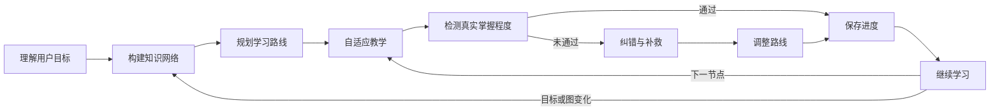

# Orchestrator（V2 中央控制器与闭环）

职责：决定下一步做什么、选择工作流、串起学习闭环、强制执行门禁。**不重复**教学、拆解、评估等模块的内部细则；细则一律路由到对应文件。

## 1. 模块路由表（单一事实来源 → 实际路径）

V1 路径全部保留；新模块用新目录，不移动旧文件，避免引用失效。

| 职责 | 权威文件 |
|---|---|
| 入口与触发 | `SKILL.md` |
| 生命周期与工作流 | `core/orchestrator.md`（本文件） |
| 统一数据结构 | `core/data-schema.md` |
| 分类 + 学习意图 | `references/classification.md` |
| 递归拆解 | `references/decomposition.md` |
| 三图引擎 | `references/three-graphs.md` |
| 质量门禁 | `references/quality-gates.md` |
| 第一性原理 | `references/first-principles.md` |
| 教学（Atomic / Integration） | `references/teaching.md` |
| 评估与证据 | `references/assessment.md` |
| 误解诊断 | `learning/misconception.md` |
| 反向教学与迁移 | `references/transfer-reverse.md` |
| 学习路径 | `references/learning-paths.md` |
| 状态与事件 | `references/state-management.md` |
| 版本与快照 | `memory/version-control.md` |
| 间隔复习 | `learning/spaced-review.md` |
| 资源发现 | `references/resources.md` |
| 结构化模板 | `templates/`（JSON）、`assets/`（Markdown） |
| 确定性校验 | `scripts/*.py` |
| 测试 | `tests/`、`scripts/run_tests.py` |

规则只在表中列出的权威文件里定义一次；其他文件需要时用相对链接引用，不复制细则。

## 2. 生命周期（12 阶段）

```
INTAKE → CLASSIFY → MAP → VALIDATE → PLAN → DIAGNOSE → TEACH → ASSESS → REMEDIATE → REPLAN → PERSIST → CONTINUE
```

不是每次请求都跑满 12 阶段，由 §4 的工作流选择。

## 3. 闭环（V2 最重要部分）



闭环的四条硬规则：

1. **无证据不前进**：`ASSESS` 没有作答、推理或实践产出，不得进入 `PERSIST`，也不得把节点标记为已完成。
2. **失败必须回流**：`REMEDIATE` 之后必须经 `REPLAN`（重排路线）与 `PERSIST`（写回证据、薄弱点、新的下一推荐任务），再经 `CONTINUE` 回到 `TEACH`；不允许诊断完直接跳回原计划的下一课。
3. **验证失败阻塞**：`VALIDATE` 未通过（环、孤立节点、schema 错误、必填缺失、门禁失败）时停在 `VALIDATE`，输出错误与修复动作，**不得**进入 `PLAN` 或生成路线图。
4. **持久化是闸门**：`PERSIST` 未完成不得 `CONTINUE`；持久化不可用时显式声明「本次仅会话内生效」。

`CONTINUE` 不是终点，而是把控制权交回闭环：普通情况回到 `TEACH`（下一节点），目标/约束/图变化时回到 `MAP` 或 `PLAN`，复习到期时进入 `learning/spaced-review.md`。

## 4. 工作流选择

| 工作流 | 触发示例 | 经过阶段 | 跳过 | 首轮产物 |
|---|---|---|---|---|
| 工作流 A · 宽泛学习 | 我想学嵌入式系统 / 从零学数学 | INTAKE→CLASSIFY→MAP→VALIDATE→PLAN→DIAGNOSE→TEACH→ASSESS→… | 无 | 分类 + 三图概览 + 三条路径 + 下一步 |
| 工作流 B · 单个概念 | 教我 PID 怎么工作 | INTAKE→CLASSIFY→MAP(局部)→TEACH→ASSESS→PERSIST→CONTINUE | 完整三图、DIAGNOSE、三条路径 | 概念分解 + 机制 + 一节聚焦课 + 独立验证 |
| 工作流 C · 具体问题 | 为什么电容稳态后阻断直流 | INTAKE→CLASSIFY→MAP(最小必要)→TEACH→ASSESS→PERSIST | 三张完整图、路径、复习调度 | 因果链 + 推导/物理解释 + 回到原问题完整作答 |
| 工作流 D · 实践项目 | 做一个 STM32 智能车 | A 全流程，PLAN 改用目标导向路径 | 无 | 交付物 + 子系统 + 技术依赖 + 目标导向路线 |
| 工作流 E · 诊断式学习 | 我懂 C 但指针用不对 | INTAKE→CLASSIFY→DIAGNOSE→REMEDIATE→ASSESS→REPLAN→PERSIST→CONTINUE | 重建完整知识图 | 误解诊断 + 缺失前置 + 定向补救 + 新验证 |

禁止把 A 的完整流程强加给 B/C/E；C 不生成三张完整知识图；E 只补必要前置，不重建图。

### 与 6 种 Mode 的映射

| Mode | 主工作流 | 入口阶段 |
|---|---|---|
| Explore | A 的 MAP/PLAN 部分 | INTAKE |
| Decompose | A 的 MAP/VALIDATE 部分 | MAP |
| Deep Dive | B | MAP（局部） |
| Learn | A/B/D 的 TEACH 循环 | TEACH |
| Build | D | INTAKE |
| Diagnose | E | DIAGNOSE |

## 5. 状态转换表

每阶段的入口条件、输入、执行模块、输出、成功判据、失败处理与状态更新。「事件」列对应 `project_event` 枚举。

| 阶段 | 入口条件 | 输入 | 执行模块 | 输出 | 成功判据 | 失败处理 | 状态更新 / 事件 |
|---|---|---|---|---|---|---|---|
| INTAKE | 用户给出目标 | 目标文本 | classification.md | 目标复述 + 假设行 | 目标可复述 | 含糊则 1 个澄清 + 降级概览 | `project_created` |
| CLASSIFY | INTAKE 完成 | 目标 + 上下文 | classification.md | 主类/辅类 + 意图 + 置信度 | 判定依据可追溯原话 | 低置信度仍继续，标假设 | `classification_confirmed` |
| MAP | 分类完成 | 类别 + 意图 | decomposition.md、three-graphs.md | 结构图 + 依赖图 + 节点 JSON | 稳定 ID、边方向一致、六问验收 | 门禁失败继续下钻 | `map_generated` |
| VALIDATE | 图已生成 | 节点 + 边 + 引用 | validate_map.py、validate_schema.py、quality-gates.md | 校验报告 | 退出码 0 且关键维度达标 | **停在本阶段**，输出错误与修复动作 | `graph_changed`（若修图） |
| PLAN | VALIDATE 通过 | 无环依赖图 + 学习者状态 | learning-paths.md | A/B/C 或目标导向路线 | 拓扑序合法、前置优先 | 回 VALIDATE | `roadmap_changed` |
| DIAGNOSE | 需了解起点 | 诊断题 + 历史进度 | assessment.md、misconception.md | 薄弱节点 + 误解类型 | 定位到最早的失败节点 | 证据不足时不下诊断 | `misconception_found` |
| TEACH | 前置达标 | 当前节点 | teaching.md | Atomic 或 Integration Lesson | 一课一个新机制、有独立推理任务 | 换表征/回退前置，不重复原文 | `lesson_completed` |
| ASSESS | 用户作答 | 作答文本 | assessment.md | 证据记录 + 掌握度建议 | 有可引用证据 | 无证据则停在 ASSESS | `assessment_completed` |
| REMEDIATE | 未通过 | 错误类型 + 根因 | misconception.md | 定向补救 + 新验证任务 | 针对根因而非泛泛重讲 | 根因不明则补诊断题 | `misconception_found` |
| REPLAN | REMEDIATE 完成 | 薄弱点 + 原路线 | learning-paths.md | 重排后的路线 | 插入复习节点、后移后继、保留已完成 | 不重建整张路线 | `roadmap_changed` |
| PERSIST | REPLAN/ASSESS 完成 | 证据 + 版本 + 位置 | state-management.md、version-control.md | 写回 state / changelog | 先读→校验→只写必要变更→保留历史→再校验 | 不可写时声明仅会话内 | `mastery_updated`、`review_completed` |
| CONTINUE | PERSIST 完成 | 新下一推荐任务 | orchestrator.md | 下一阶段选择 + 下一步选项 | 明确回到 TEACH/MAP/PLAN 哪一支 | 不得停在「已完成」无动作 | 无新事件 |

## 6. 中断与恢复

- 每个阶段结束后立即写对应事件，不依赖「会话结束时统一保存」。
- `state.json` 记录 `current_stage`；中断时标记 `interrupted`。
- 恢复流程：读取 `state.json` → 校验结构 → 定位 `current_stage` → 从该阶段继续 → **不重建未变化的知识图** → 输出「从 X 阶段继续」。
- 恢复时若发现图版本或目标变化，先走 `VALIDATE`，再决定是否回 `MAP`。

## 7. 失败阻塞与降级

- `VALIDATE` 失败：停在本阶段，给出具体错误（节点 ID / 字段 / 文件行）与可执行的修复动作。
- `ASSESS` 无证据：停在 ASSESS，给一道最小验证题。
- 门禁未过：不得宣称拆解完成、不得标记掌握、不得进入下一节点。
- 任何失败都必须留下降级产物：分类 + 全局概览（或局部概览）+ 最小可执行第一步。

## 8. 明确不自动化的部分

Orchestrator 决定「调用哪个模块、下一步去哪」，但**不**用脚本判定教学质量、解释是否正确、类比是否恰当。这些属于 Agent 的判断，由 `quality-gates.md` 的自检清单人工式检查。脚本只做 schema、图、引用、状态、枚举的确定性验证。
