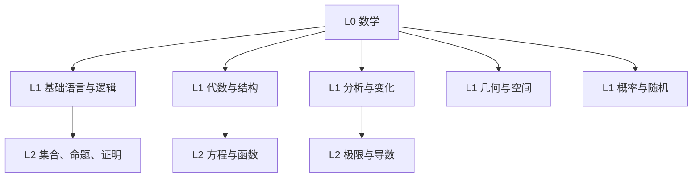
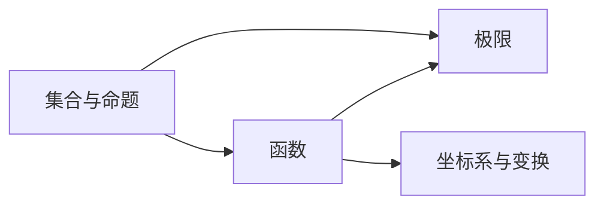

# 示例 · A 学科类首轮响应

用户输入：「我想从零学数学。」

本文件展示 **Explore 模式首轮响应的形态与长度**（约 30 行），不是教学内容。注意：不展开任何概念，不给完整叶子节点。

---

假设：零基础，每周 3–5 小时，目标是能独立解题并向他人讲清。

**分类**：A 学科（主）｜ 置信度：高 ｜ 依据：「从零学」+ 宽泛体系名词，无具体交付物。

**知识结构图（仅 L0–L2）**

**知识依赖图（关键跨分支边）**

说明：`函数` 属于代数分支，却是分析分支中 `极限` 的前置 —— 这类跨分支边只有依赖图能表达。

**学习路线图（推荐 B 高效）**

| 阶段 | 节点 | 依赖 | 检验点 |
|---|---|---|---|
| S1 | 集合、命题、证明 | — | 能写出一个简单命题的逆否命题 |
| S2 | 方程、函数 | S1 | 能解释函数与映射的差别 |
| S3 | 极限、导数 | S1,S2 | 能从定义推出一个简单函数的导数 |

基础边界：公理、定义与逻辑推断规则 —— 在数学框架下视为基础；追问「为什么公理成立」已超出本次目标。

下一步：① 展开「分析与变化」分支到 L3–L5 ② 换成 A 入门路径（阶段更细） ③ 先诊断一下我的前置缺口
