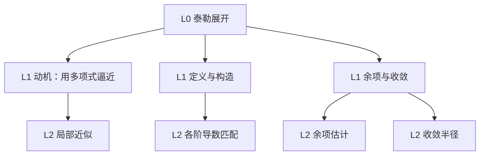
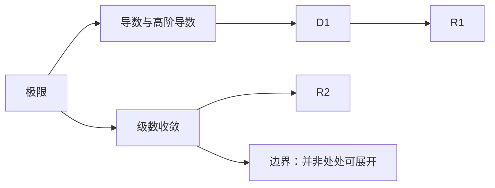

# 示例 · B 知识点类首轮响应（Deep Dive / Decompose）

用户输入：「我想彻底搞懂泰勒展开。」

展示：概念类如何「深挖 + 补前置 + 显式的机制与基础边界」，且首轮仍不倾倒教学正文。

---

假设：具备基本求导，不熟悉级数与收敛；目标是能独立推导并讲清它为什么不总是成立。

**分类**：B 单个知识点（主）+ E 具体问题（辅）｜ 置信度：高 ｜ 依据：单一概念名词 + 「彻底搞懂」。

**知识结构图（L0–L3）**

**知识依赖图（跨分支边）**

**底层逻辑**：用「在某点处函数值及各阶变化率全部匹配」构造多项式 —— 解释 `D1` 与 `R1`；收敛性决定该逼近在多大范围内有效 —— 解释 `R2` 与边界。

**前置知识**：极限与连续（必须先补）、高阶导数（必须先补）、级数收敛（必须先补）、复数域解析性（用到再查）。

**学习路径**：S1 极限与高阶导数 → S2 逐阶匹配构造 → S3 余项推导 → S4 收敛半径与反例 → S5 迁移与反向教学。

**常见误解**：把「有各阶导数」等同于「可展开为泰勒级数」；把有限项近似当作恒等式。

**六问验收（V2）**：为什么存在（用多项式局部逼近）｜解决什么（把复杂函数在一点附近变简单）｜依赖基础（极限、高阶导数、级数收敛）｜为什么成立（各阶导数匹配 + 余项可控）｜能否推导（逐阶匹配可得系数）｜如何证明真懂（推余项、举出不可展开的反例、迁移到数值逼近）。

**反目录化对照**：`定义 / 性质 / 应用 / 常见题型` 这种四行目录不算拆解；上面六问齐全才叫拆到原子 —— 深度不等于目录长度。

基础边界：实数完备性与极限定义 —— 在数学分析框架下视为基础，理由：继续追问进入实变函数与公理化集合论。

下一步：① 从 S2 开始上第一课 ② 只看依赖图并让我选一个前置 ③ 直接给我一道迁移题测测看
