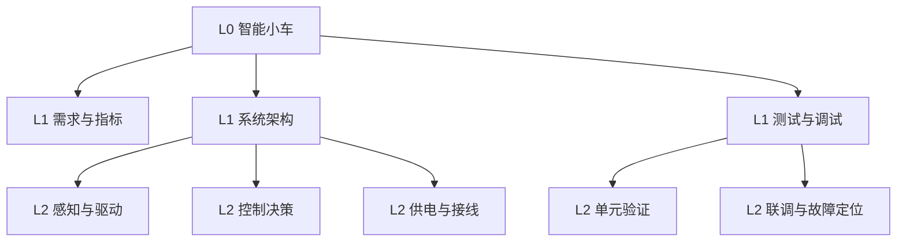
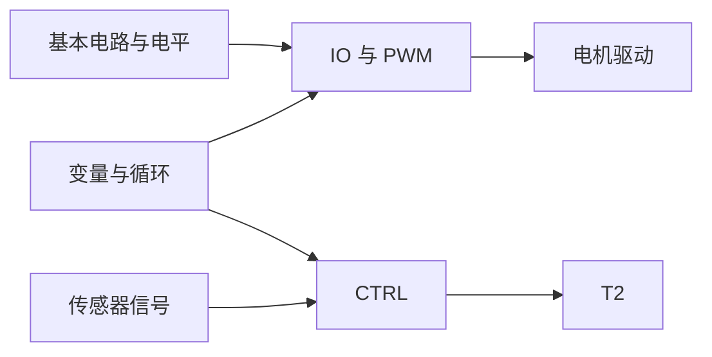

# 示例 · F 项目类首轮响应（Build）

用户输入：「我想做一个智能小车。」

展示：项目类如何「从终点逆推 + 补知识 + 标关键路径」，而不是直接给代码或堆技术清单。

---

假设：单人完成，可用周末时间，目标是能自主循迹并避障的可运行样机；不含机械结构设计图。

**分类**：F 项目目标（主）+ C 技术域（辅）｜ 置信度：高 ｜ 依据：有明确交付物「做一个…」。

**完成标准**：小车能在指定路径上自主行驶，遇障碍停止或绕行，且能被复现地调试。

**知识结构图（逆向拆解，L0–L2）**

**知识依赖图（跨分支边）**

**关键路径**：`传感器信号 → 控制决策 → 电机驱动` —— 最易卡在「信号噪声与响应延迟」，其前置需拆得更细。

**需补知识**：电平与 PWM（必须先补）、基本控制逻辑（必须先补）、误差与反馈（用到再查）、机械安装（可临时查）。

**实施路线**：S1 让电机按指令转动 → S2 读回传感器并打印 → S3 闭环决策 → S4 联调与故障定位 → S5 指标验证。

**兜底**：先用现成驱动模块替代手写驱动；先做「能直线走」的最小版本，再迭代避障。

下一步：① 展开「控制决策」分支并递归拆解 ② 从 S1 开始，给我第一课 ③ 先诊断我的前置缺口
