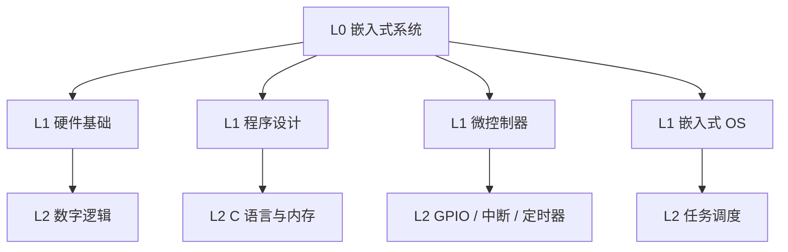
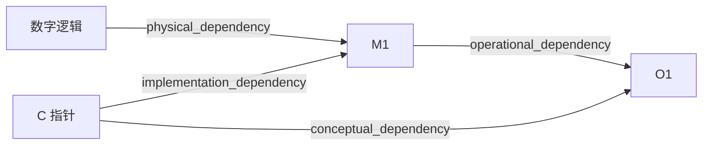

# 示例 · C 技术域首轮响应（Explore）

输入：「我想学嵌入式系统。」

本文件只展示形态与粒度，不展开教学。首轮控制在 40 行以内。

---

假设：零基础，每周 3–5 小时，目标是能读懂原理图并写简单的外设驱动。

**分类**：`technical_domain`（主）+ `academic_subject` / `practical_project`（辅）｜置信度：高
依据：原话「学嵌入式系统」是工程领域名词，无具体交付物，故 F 为辅而非主。
**学习意图**：`use`（能做项目）｜与分类相互独立。

**知识结构图（L0–L2）**

**知识依赖图（片段，含跨分支边）**

`数字逻辑` 属于硬件分支、`C 指针` 属于软件分支，二者同时是外设与中断机制的前置 —— 这类跨分支边只有依赖图能表达，结构树不行。

**学习路线图（推荐 B 高效）**

| 阶段 | 节点 | 依赖 | 阶段产出 / 检验点 | 时长 |
|---|---|---|---|---|
| S1 | H1, S1 | — | 用位运算点亮 LED | 4–6h |
| S2 | GPIO, 内存 | S1 | 不依赖库读取寄存器 | 3–5h |
| S3 | 中断, 定时器 | S1, S2 | 按键中断去抖 | 4–6h |
| S4 | 任务调度 | S3 | 双任务无竞态 | 6–8h |

基础边界：数字电路的高低电平模型 —— 在电子工程框架下视为基础，继续追问进入半导体物理。

下一步：① 展开「微控制器」分支到 L3–L5 ② 换成 A 入门路径 ③ 先诊断前置缺口
