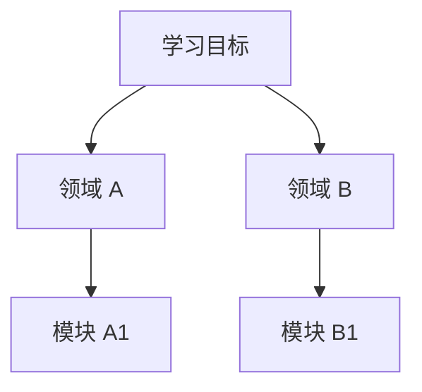
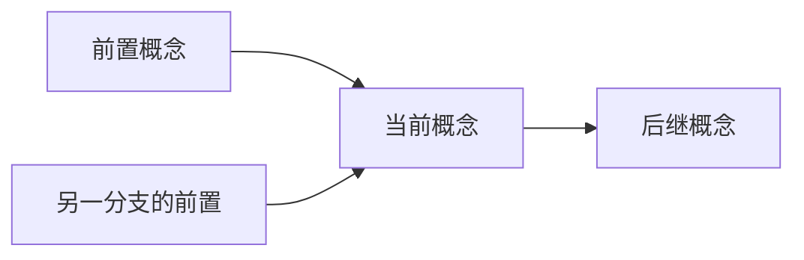

# 三图引擎（结构图 / 依赖图 / 路线图）

建图或更新图时载入。本文件是 DeepLearn 最核心的规范。

## 为什么必须是三张图

同一批知识节点，三种关系回答三个不同问题。**把依赖边画进结构树、或把教材章节顺序当作路线图，是最常见的错误。**

| 图 | 边语义 | 回答 | 允许的结构 |
|---|---|---|---|
| 知识结构图 | `A --> B` 表示 A **包含** B | 这个知识由哪些部分组成 | 树 / 分层，父唯一 |
| 知识依赖图 | `A --> B` 表示 **先掌握 A 才能学 B** | 学会它之前必须会什么 | DAG，允许多父、跨分支 |
| 学习路线图 | `S1 --> S2` 表示 **阶段时序** | 按什么顺序学 | 线性阶段序列 + 阶段属性 |

关键区别：结构图的节点只有一个父节点；依赖图的节点可以有多个前置，且这些前置常常来自**不同的结构分支**。树无法表达这一点。

## 生成流程

1. 结构图：按类别分解链展开（见 decomposition.md），只表达包含。
2. 依赖图：为结构图每个节点补 `prerequisites[]`，把「必须先于」写成独立有向边。
3. 路线图：对依赖图拓扑排序，叠加难度、重要性、时长、必/选，合并为阶段。
4. 三图共用同一套节点 ID；更新时只改受影响分支，保持 ID 稳定。

## 跨分支边发现清单

对每个节点逐条问，命中即补边（这些边在结构图里不存在）：

- 理解它需要另一个分支的**术语或记号**吗？
- 它的推导用到了另一个分支的**数学/物理工具**吗？
- 动手实践它需要另一个分支的**操作能力**吗？
- 它的反例或局限来自另一个分支吗？
- 它在真实系统里与另一个分支的组件有**接口**吗？

示例：`中断` 同时依赖 `数字逻辑`（硬件层）与 `C 指针`（软件层），二者分属不同 L1 分支；`任务调度` 依赖 `中断` 与 `内存管理`。这些边只能在依赖图里出现。

## Mermaid 模板

结构图（默认只展示到 L2）：

依赖图（边从前置指向后继）：

路线图用表格而非 Mermaid，因为阶段需要携带属性：

| 阶段 | 节点 | 依赖阶段 | 阶段产出 / 检验点 | 时长 |
|---|---|---|---|---|
| S1 | … | — | … | 3–5h |

## 环检测与破环

- 依赖图必须无环。运行 `scripts/validate_map.py`（支持 Mermaid 与 JSON 输入）。
- 检测到环时，不要删除边掩盖问题；把环上某个节点拆成两步：`X-会用`（只要求会操作，前置从环上移除）→ `X-原理`（依赖其它环上节点），并注明「先会用」阶段暂略原理的代价。
- 破环后重新校验，通过后才允许生成路线图。

## 零孤立节点（V2 硬约束）

知识点彼此孤立，等同于没有建立依赖网络。生成依赖图后：

- 除显式声明「基础边界」的节点外，每个节点至少有一条入边或出边。
- 运行 `scripts/validate_map.py --strict`：存在孤立节点即退出 1，必须补边或给出理由。
- 补边优先按上面的「跨分支边发现清单」找跨分支依赖，不随便连一条同类边凑数。
- 确实独立的节点写成一行声明：`基础边界：<名称> —— 理由：<…>`，并在结构图中标注。
- 依赖图与结构图共用节点 ID；任何新增节点都要同时补依赖边。

## 渐进披露

- 大目标首轮只给 L0–L2 与三图概览，≤40 行。
- 用户选中某分支后，才展开该分支的 L3–L6 与对应依赖边。
- 不因为「图应该完整」一次性倾倒全部叶子节点。
- 每次展开都在末尾给「下一步：…」供用户继续选择。

## 三图同步规则

| 事件 | 结构图 | 依赖图 | 路线图 |
|---|---|---|---|
| 用户完成一个节点 | 不变 | 不变 | 标记进度 |
| 发现遗漏前置 | 可能新增节点 | 补边 + 重新校验 | 重排受影响阶段 |
| 用户切换 Mode | 不变 | 不变 | 换视角，不重建 |
| 用户追加约束 | 不变 | 不变 | 只调时长 / 必选标记 |
| 基础边界确认 | 追加边界标注 | 该节点标记为根 | 可作为起点 |

## 常见错误（显式禁止）

- 用结构图的父子关系直接当学习顺序。
- 依赖图里出现环却继续输出路线图。
- 把「推荐先读第 3 章」这类教材顺序当作依赖依据。
- 结构图里画 `必须先于` 的边，导致节点出现多个父节点。
- 三张图使用不一致的节点名称或 ID。
